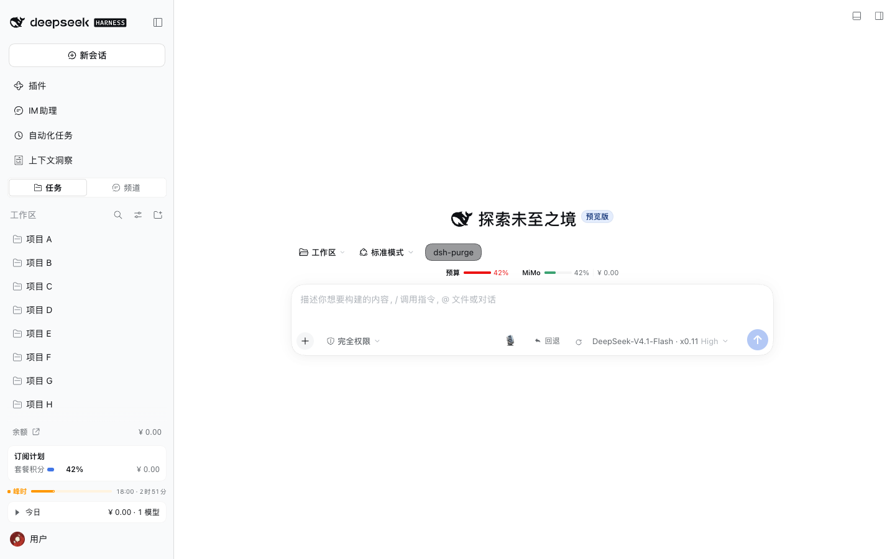
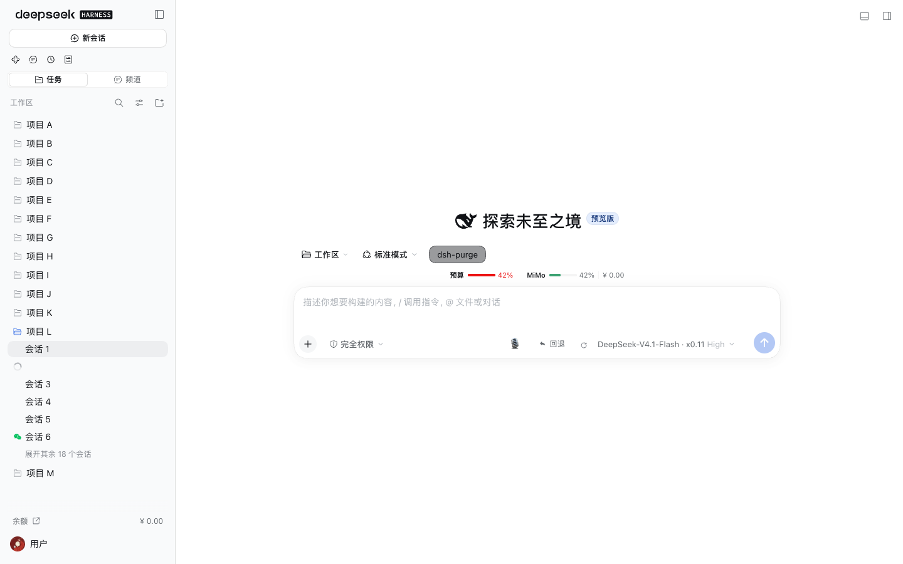
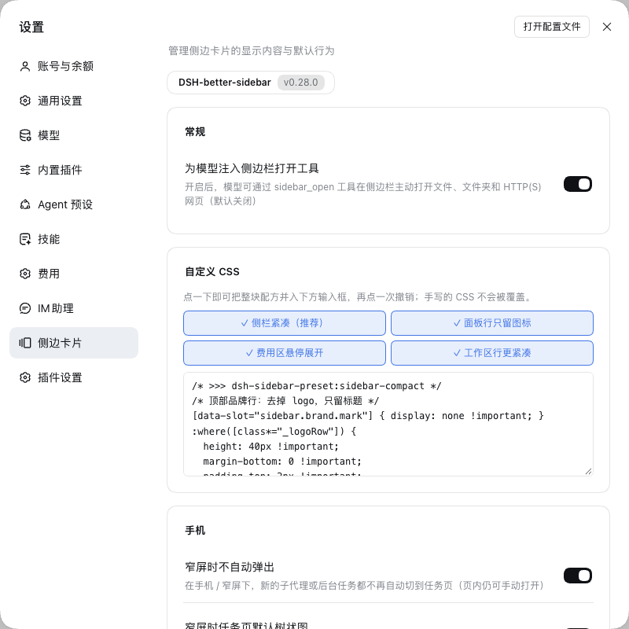
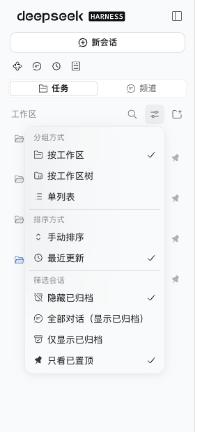
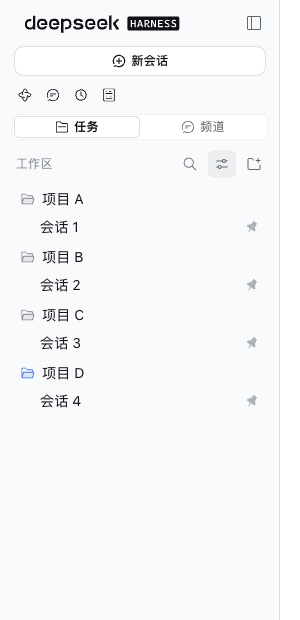

# dsh-sidebar-css-recipes

[简体中文](README.md) | **English** | [日本語](README.ja.md)

> Reclaim DSH sidebar height with a few lines of CSS — give the space back to your session list. **No new plugin required.**

---

## Why

The DSH sidebar spends a lot of vertical space on things you glance at once per session.

**Before** — four stacked panel rows and a fully expanded cost block leave the workspace 311px:



**After** — panels collapse to one icon strip, the cost block keeps one line, the workspace grows to 634px:



> Screenshots taken at 1440×900 on a real machine. Workspace names and session titles are
> replaced with placeholders; amounts are zeroed.

The workspace tree — the only part you scroll — gets **311px of 900**.

After four CSS blocks: **634px**.

| Block | Before | After | Saved |
|---|---|---|---|
| Panel rows | 156px | 26px | **130px** |
| Cost block | 163px | 22px | **141px** |
| Brand row + new session | 98px | 70px | 28px |
| Tasks / Channels tabs | 32px | 26px | 6px |
| **Workspace tree** | **311px** | **634px** | **+323px** |

Measured at 1440×900. Tree row height also drops 34 → 26px, fitting 4-5 more rows.

## Why not a plugin

**The fewer plugins installed, the better.**

If you already run [dsh-better-sidebar](https://github.com/omdsh-dev/DSH-better-sidebar),
its settings page already has a **Custom CSS** box — an injection pipeline that is already
running. This repo only fills that box. Nothing extra to install.

There's also an optional script that adds four clickable preset buttons above that box,
for when you'd rather not copy-paste from a doc.

## Two ways to use it

### Option 1: paste the CSS (simplest, zero tooling)

Open **DSH Settings → Side card → Custom CSS** and paste the blocks you want from
[`css-recipes.md`](css-recipes.md).

Mix and match freely. Tweak numbers, or delete a block entirely.

### Option 2: apply the patch, get preset buttons

If copy-pasting every time is tedious, run one script to add four buttons above that box:

```bash
node apply-css-presets.mjs          # apply (idempotent)
node apply-css-presets.mjs --check  # check whether applied
node apply-css-presets.mjs --revert # restore the original file
```

Afterwards, **Settings → Side card → Custom CSS** shows four preset buttons:



Click to merge, click again to remove:

- Each block carries `/* >>> dsh-sidebar-preset:<id> */ … /* <<< */` markers, so clicking
  twice never duplicates it and removing deletes only its own block.
- **Your hand-written CSS is never overwritten** — presets are inserted alongside it.
- A merged block still counts as "enabled", so you can tweak its numbers directly in the textarea.

The script patches
`~/.dsh/profiles/desktop/node_modules/dsh-better-sidebar/lib/client.js` and backs up the
original as `client.js.orig-<version>` next to it on first run.

## The four recipes

See [`css-recipes.md`](css-recipes.md) for the full CSS.

| Recipe | What it does | Saves |
|---|---|---|
| Tighter sidebar top | Drops the logo, new-session 38→30px, tabs 32→26px | 60px |
| Panels as an icon strip | Four stacked rows → one icon strip; labels on hover/active | **130px** |
| Collapse the cost block | Keeps only the balance line until hover | **141px** |
| Denser workspace rows | Rows 34→26px, text 14→12px | 4-5 more rows |

## Bonus: pinned-only filtering (needs JS, not CSS)

The four recipes are about **height**. This one is about **finding things** — once you have
enough sessions, the few you pinned get buried in the tree.

DSH already has "pin", but pinning only sorts a session to the top of its group. **The filter
menu has no pinned-only option.** This adds one — a "Pinned only" row in the view-options menu:



Click it and the tree keeps only pinned sessions (and expands every group, so nothing hides
collapsed); click again to clear:



> Real 288×900 sidebar screenshots. Workspace names and session titles are placeholders.

Works in all three grouping modes (by workspace / workspace tree / flat list); search is
filtered the same way. The choice persists in `dsh.workspace.view.v5`.

**Why CSS can't do this**: the pin star is a node in the DOM. CSS could hide the star, but it
can't hide the *sibling* rows in the same group — there's no parent selector that filters on
"does this subtree contain a star". DSH's slot list has no slot for this menu item either, so a
plugin can't attach to it. Patching the shipped package is the only path.

**Do you need it**: no — it's optional, skip it. It edits
`@deepseek-ai/dsh-client-ui-workspace/lib/client.js`, with a backup and a rollback.

```bash
python3 tools/pin-filter-patch.py --check   # can it patch / is it already patched
python3 tools/pin-filter-patch.py           # apply (backs up client.js.orig first)
python3 tools/pin-filter-patch.py --revert  # restore from the backup
```

What the script does: locate the file → verify each snippet appears **exactly once** → only
then write. If any snippet isn't unique it changes nothing and names the offending one (so it
never patches the wrong copy). Reload the window (⌘R) afterwards.

**After a DSH upgrade**: the package file gets overwritten. Re-run `--check`; if it says
patchable, apply again. If it reports a missing/duplicated snippet, the upstream code moved and
the anchors need relocating — the script tells you which one.

**Limits**: zh / en dictionaries only (all DSH ships); the empty state becomes "No pinned
sessions yet" with a "view others" button.

## How it works

### Stable anchors, not hashed class names

DSH styles the sidebar with CSS modules, so class names carry a build hash
(`_3WPZCG_panelRow`) that changes every release. The recipes anchor on two things that don't:

| Anchor | Why it's stable |
|---|---|
| `[data-slot="…"]` | Written by DSH's slot system — part of the DOM contract |
| `[class*="_logoRow"]` | The hash prefix changes; the semantic half comes from source |

Semantic-anchor rules are wrapped in `:where()`, so their specificity is **zero** — your own
CSS and theme overrides still win.

### The `!important` is deliberate

DSH injects plugin stylesheets at runtime in an uncontrolled order. Without `!important` the
plugin defaults win. The cost: to change a value you edit the recipe text — which is just plain
text, so that's fine.

## After a plugin upgrade

`node_modules` gets overwritten — that's unavoidable. If you used Option 2:

```bash
node apply-css-presets.mjs
```

Re-running is enough. If the script reports "anchor not found", the plugin's internals changed
and the anchors need relocating.

**Option 1 is unaffected** — pasted CSS lives in DSH's settings, not in `node_modules`.

## Known limits

- **Collapsed rail (56px)** is unaffected — it's already icon-only.
- **The cost block** assumes the first child inside `[data-slot="sidebar.footer.action"]` is
  the balance line. If you reorder [dsh-cost-meter](https://github.com/Han-1413141/dsh-cost-meter)'s
  components, the "keep one line" rule may retain a different card — swap `> *:first-child`
  for the matching class.
- The panel icon strip **wraps** when there are more panels than fit one row; it never
  overflows horizontally.

## Requirements

- DSH `>=0.2.0-rc.1`
- Option 1: no dependencies
- Option 2: Node `>=18`
- The optional pinned-only patch: Python `>=3.9` (no third-party packages)

## License

[MIT](LICENSE)
