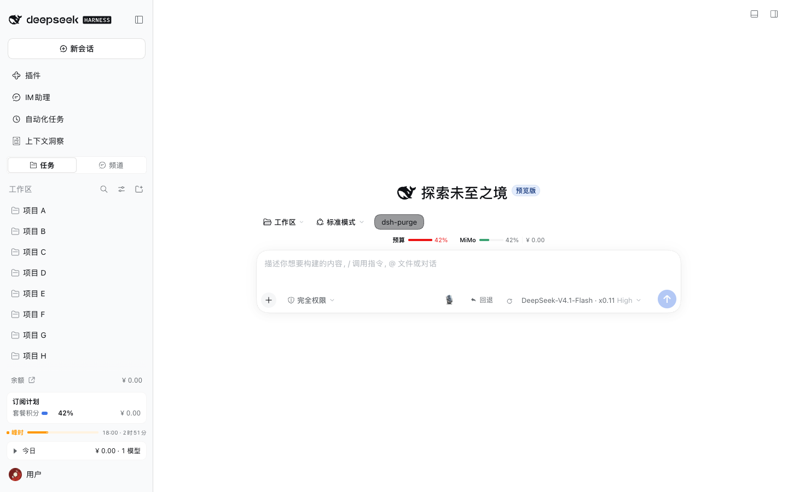
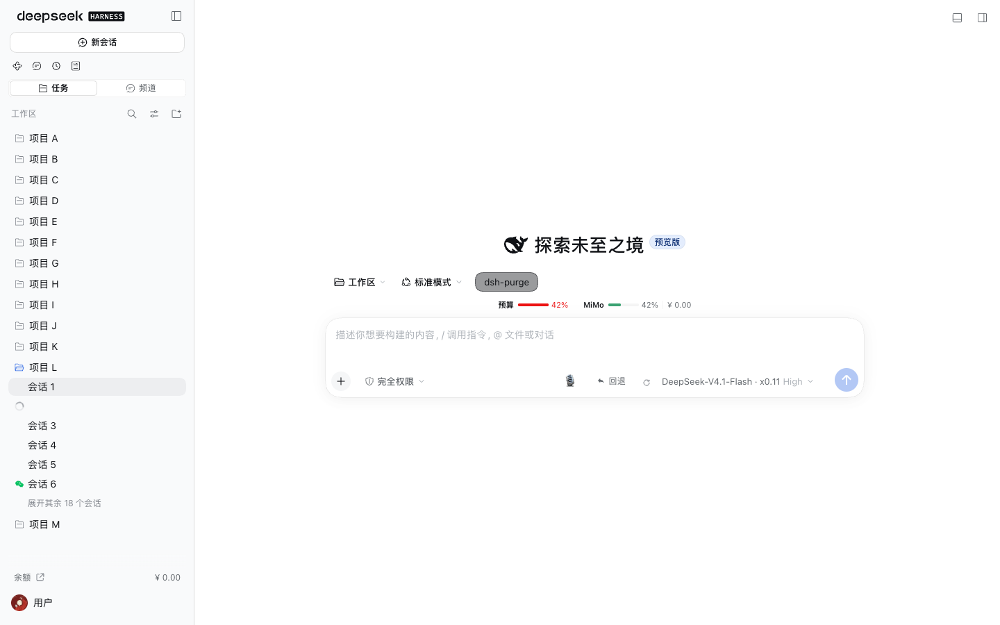
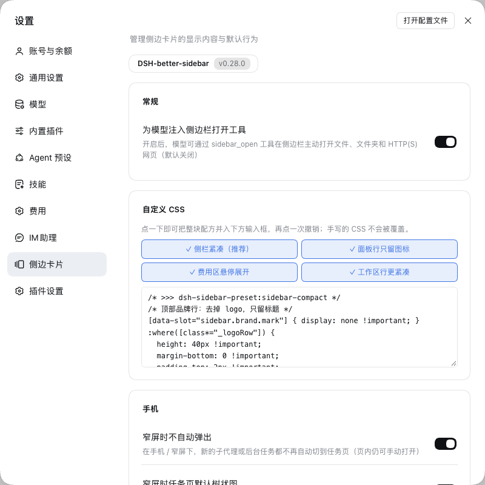

# dsh-sidebar-css-recipes

[简体中文](README.md) | [English](README.en.md) | **日本語**

> 数行の CSS で DSH サイドバーの高さを取り戻し、会話リストに回します。**新しいプラグインは不要。**

---

## なぜ

DSH のサイドバーは、セッション中に一度しか見ないものへ縦方向の空間を大量に使っています。

**変更前** —— 4 行のパネル行と全展開のコスト表示で、ワークスペースは 311px しか残りません：



**変更後** —— パネルは 1 本のアイコン列に、コスト表示は 1 行に、ワークスペースは 634px に：



> 1440×900 の実機で撮影。ワークスペース名とセッション名はプレースホルダーに置換し、
> 金額はゼロにしています。

ワークスペースツリー —— スクロールする唯一の部分 —— は **900px のうち 311px** しか
もらえていません。

4 つの CSS ブロックの後：**634px**。

| ブロック | 変更前 | 変更後 | 削減 |
|---|---|---|---|
| パネル行 | 156px | 26px | **130px** |
| コスト表示 | 163px | 22px | **141px** |
| ブランド行 + 新規セッション | 98px | 70px | 28px |
| 「タスク / チャンネル」タブ | 32px | 26px | 6px |
| **ワークスペースツリー** | **311px** | **634px** | **+323px** |

1440×900 での実測値。ツリーの行高も 34 → 26px になり、1 画面に 4〜5 行多く入ります。

## なぜプラグインにしないのか

**入れるプラグインは少ないほど良い。**

[dsh-better-sidebar](https://github.com/omdsh-dev/DSH-better-sidebar) を既に入れているなら、
その設定ページにはすでに **カスタム CSS** 欄があります —— すでに動いている注入経路です。
このリポジトリはその欄に中身を入れるだけで、追加インストールは何も要りません。

毎回コピペするのが面倒な場合のために、その欄の上に 4 つのプリセットボタンを追加する
スクリプトも用意しています。

## 2 つの使い方

### 方法 1：CSS を貼る（最も簡単、ツール不要）

**DSH 設定 → サイドカード → カスタム CSS** を開き、
[`css-recipes.md`](css-recipes.md) から必要なブロックを貼り付けます。

自由に組み合わせ可能。数値を変えてもよく、ブロックごと削除しても構いません。

### 方法 2：パッチを当ててプリセットボタンを得る

毎回コピペするのが面倒なら、スクリプト 1 回でその欄の上に 4 つのボタンを追加できます：

```bash
node apply-css-presets.mjs          # 適用（冪等）
node apply-css-presets.mjs --check  # 適用済みか確認
node apply-css-presets.mjs --revert # 元のファイルに戻す
```

実行後、**設定 → サイドカード → カスタム CSS** の上に 4 つのプリセットボタンが現れます：



クリックで取り込み、もう一度クリックで解除：

- 各ブロックは `/* >>> dsh-sidebar-preset:<id> */ … /* <<< */` のマーカーを持つため、
  二度クリックしても重複せず、解除は自分のブロックだけを削除します。
- **手書きの CSS は一切上書きされません** —— プリセットは横に挿入されるだけです。
- 取り込んだブロックも「有効」と見なされるので、テキストエリアで数値を直接微調整できます。

スクリプトは
`~/.dsh/profiles/desktop/node_modules/dsh-better-sidebar/lib/client.js` を書き換え、
初回実行時に元ファイルを同ディレクトリへ `client.js.orig-<バージョン>` として退避します。

## 4 つのレシピ

完全な CSS は [`css-recipes.md`](css-recipes.md) を参照。

| レシピ | 内容 | 削減 |
|---|---|---|
| サイドバー上部を圧縮 | ロゴを外し、新規セッション 38→30px、タブ 32→26px | 60px |
| パネル行をアイコン列に | 4 行の縦積み → 1 本のアイコン列。ホバー/選択時にラベル | **130px** |
| コスト表示を折りたたむ | ホバーまで残高の 1 行だけを表示 | **141px** |
| ワークスペース行を高密度に | 行 34→26px、文字 14→12px | 4〜5 行増 |

## 仕組み

### ハッシュ化されたクラス名ではなく、安定したアンカー

DSH は CSS modules でサイドバーを装飾するため、クラス名にビルドハッシュ
（`_3WPZCG_panelRow`）が付き、リリースごとに変わります。レシピは変わらない 2 つに
アンカーします：

| アンカー | 安定している理由 |
|---|---|
| `[data-slot="…"]` | DSH のスロットシステムが DOM に書く属性。契約の一部 |
| `[class*="_logoRow"]` | ハッシュ接頭辞は変わるが、意味部分はソース由来 |

意味アンカーの規則は `:where()` で包み、詳細度を **0** にしています ——
あなた自身の CSS やテーマの上書きが依然として勝ちます。

### `!important` は意図的

DSH はプラグインのスタイルシートを実行時に注入し、順序を制御できません。
`!important` がないとプラグインの既定値に負けます。代償として、値を変えるには
レシピ本文を編集する必要があります —— ただしレシピはただのテキストなので問題ありません。

## プラグイン更新後

`node_modules` が上書きされるのは避けられません。方法 2 を使った場合：

```bash
node apply-css-presets.mjs
```

再実行すれば十分です。スクリプトが「アンカーが見つからない」と報告した場合は、
プラグインの内部構造が変わったので、アンカーの再特定が必要です。

**方法 1 は影響を受けません** —— 貼り付けた CSS は `node_modules` ではなく
DSH の設定に保存されます。

## 既知の制限

- **折りたたみレール（56px）** は影響を受けません —— もともとアイコンのみです。
- **コスト表示** は `[data-slot="sidebar.footer.action"]` の最初の子要素が残高行である
  ことを前提にしています。[dsh-cost-meter](https://github.com/Han-1413141/dsh-cost-meter)
  のコンポーネント順を変えた場合、「1 行だけ残す」規則が別のカードを残す可能性が
  あります —— `> *:first-child` を該当クラス名に置き換えてください。
- パネルのアイコン列は、1 行に収まらない数になると**折り返します**。
  横にはみ出しません。

## 動作要件

- DSH `>=0.2.0-rc.1`
- 方法 1：依存なし
- 方法 2：Node `>=18`

## ライセンス

[MIT](LICENSE)
