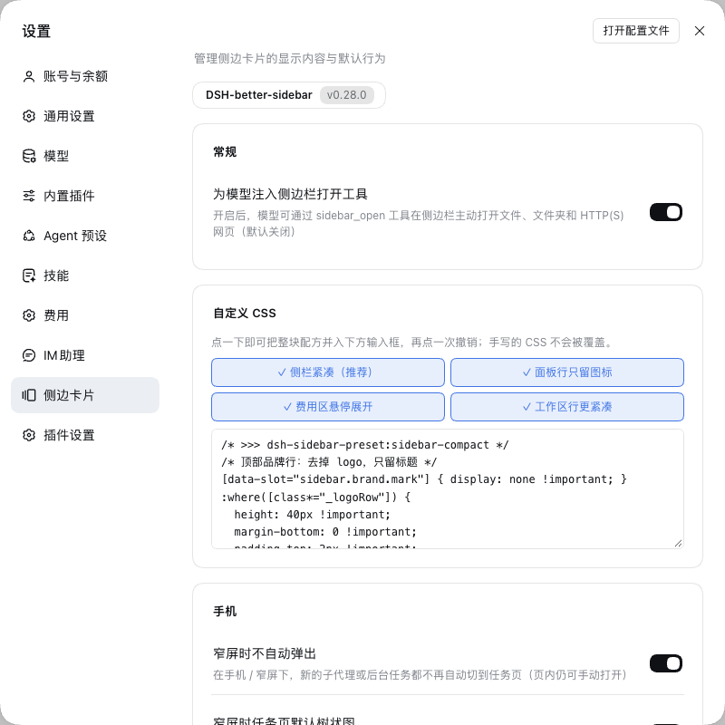

# dsh-sidebar-css-recipes

**简体中文** | [English](README.en.md) | [日本語](README.ja.md)

> 一行 CSS 回收 DSH 侧栏高度，把空间还给会话列表。**不装新插件。**

---

## 为什么

DSH 侧栏把大量纵向空间花在一次会话只看一眼的地方。

**改前**（四个面板行竖排、费用区全展开，工作区只剩 311px）：


**改后**（面板行压成一行图标条、费用区只剩余额，工作区涨到 634px）：


> 截图为 1440×900 实机运行，工作区名与会话标题已替换为占位词，金额已归零。

工作区树——唯一需要滚动的那部分——只分到 **900px 里的 311px**。

四段 CSS 之后：**634px**。

| 区域 | 改前 | 改后 | 省下 |
|---|---|---|---|
| 面板行 | 156px | 26px | **130px** |
| 费用区 | 163px | 22px | **141px** |
| 品牌行 + 新会话 | 98px | 70px | 28px |
| 「任务 / 频道」页签 | 32px | 26px | 6px |
| **工作区树** | **311px** | **634px** | **+323px** |

1440×900 窗口实测。工作区行高同时 34 → 26px，一屏多显示四到五行。

## 为什么不做成插件

**能少装一个插件就少装一个。**

如果你已经装了 [dsh-better-sidebar](https://github.com/omdsh-dev/DSH-better-sidebar)，
它设置里本来就有「自定义 CSS」输入框 —— 一条已经在跑的注入管线。
这个仓库只是往那个框里填内容，不需要额外安装任何东西。

同理，下面也提供**不用手动粘贴**的脚本方案：给那个输入框加四个可点的配方按钮。

## 两种用法

### 方式一：直接粘贴（最简单，零工具）

打开 **DSH 设置 → 侧边卡片 → 自定义 CSS**，把
[`css-recipes.md`](css-recipes.md) 里想要的段落粘进去。

四段可任意组合。想微调就改数值，想删就整段删掉。

### 方式二：打补丁，得到可点的配方按钮

如果你嫌每次都翻文档复制，跑一个脚本，让那个输入框上方多出四个按钮：

```bash
node apply-css-presets.mjs          # 打补丁（幂等）
node apply-css-presets.mjs --check  # 查看是否已打
node apply-css-presets.mjs --revert # 还原成原版
```

打完之后，**设置 → 侧边卡片 → 自定义 CSS** 上方会出现四个配方按钮：



点一下并入、再点一下撤销：

- 每块配方带 `/* >>> dsh-sidebar-preset:<id> */ … /* <<< */` 边界标记，
  重复点不会产生第二份，撤销只删自己那块。
- **你手写的 CSS 完全不会被覆盖**，配方只是插进去。
- 标记块里的内容仍然算「已启用」，可以直接在文本框里改数值微调。

脚本写的是 `~/.dsh/profiles/desktop/node_modules/dsh-better-sidebar/lib/client.js`，
首次运行会把原文件备份成同目录的 `client.js.orig-<版本>`。

## 四段配方

详见 [`css-recipes.md`](css-recipes.md)。

| 配方 | 作用 | 省下 |
|---|---|---|
| 侧栏顶部紧凑 | 去掉 logo、新会话 38→30px、页签 32→26px | 60px |
| 面板行只留图标 | 四行竖排压成一行图标条，悬停/选中才显文字 | **130px** |
| 费用区悬停展开 | 只留「余额」一行，鼠标移上去完整展开 | **141px** |
| 工作区行更紧凑 | 行高 34→26px，字号 14→12px | 多显示 4-5 行 |

## 原理

### 用稳定锚点，不用哈希类名

DSH 用 CSS modules 给侧栏加样式，类名带构建哈希（`_3WPZCG_panelRow`），每次发版都变。
配方锚定在两样不变的东西上：

| 锚点 | 为什么稳定 |
|---|---|
| `[data-slot="…"]` | DSH 插槽系统写在 DOM 上的属性，属于契约的一部分 |
| `[class*="_logoRow"]` | 哈希前缀会变，语义那半截来自源码 |

语义锚点的规则套了 `:where()`，特异性压到 **0** —— 你自己的 CSS 和主题覆盖仍然能赢。

### 用 `!important` 是刻意的

DSH 的插件样式表在运行时注入，顺序不可控。不加 `!important` 会被插件的默认值盖掉。
代价是改数值要改配方本身 —— 但配方就是纯文本，改起来没有门槛。

## 升级后怎么办

`node_modules` 被覆盖是必然的。如果用了方式二：

```bash
node apply-css-presets.mjs
```

重跑一次即可。脚本报「找不到 XXX 锚点」说明插件内部结构变了，需要按新代码重新定位。

**方式一不受影响** —— 粘贴的 CSS 存在 DSH 设置里，升级插件不会丢。

## 已知边界

- **折叠态（56px 窄栏）** 不受影响 —— 那里本来就是纯图标。
- **费用区** 假设 `[data-slot="sidebar.footer.action"]` 的第一个子元素是余额行。
  如果你调整了 [dsh-cost-meter](https://github.com/Han-1413141/dsh-cost-meter) 的组件顺序，
  「只留一行」可能留住别的卡片 —— 把 `> *:first-child` 换成对应类名即可。
- 面板行图标条在**面板数量超过一行能放下的宽度**时会换行，不会横向溢出。

## 环境

- DSH `>=0.2.0-rc.1`
- 方式一：无依赖
- 方式二：Node `>=18`

## 许可

[MIT](LICENSE)
